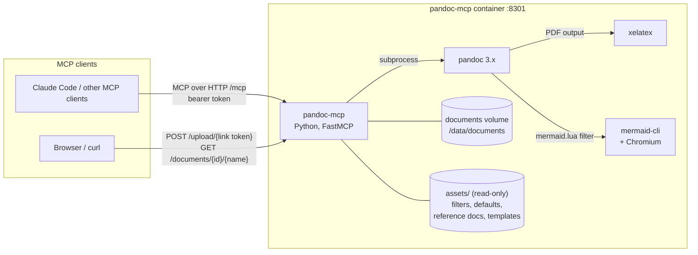
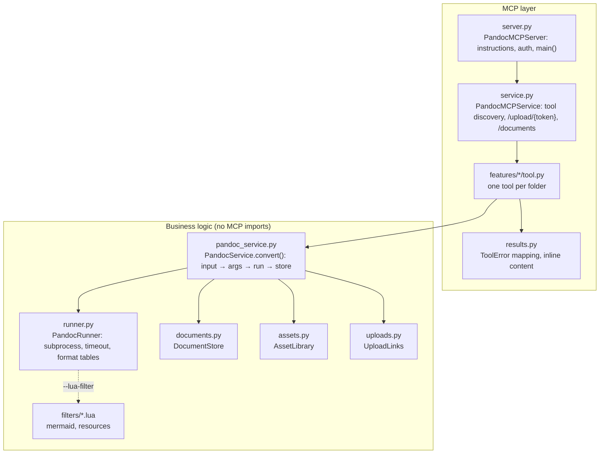
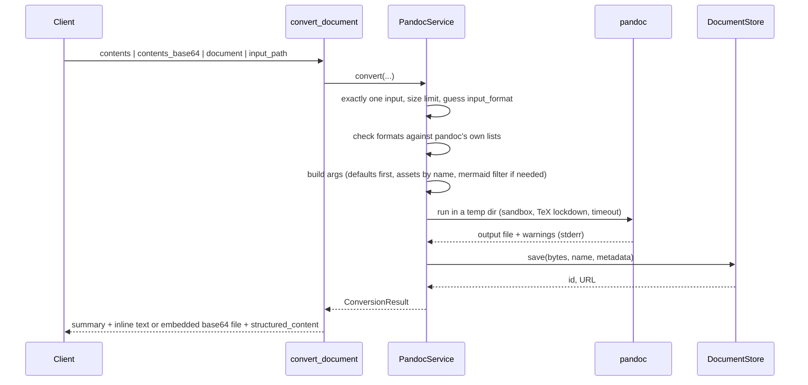
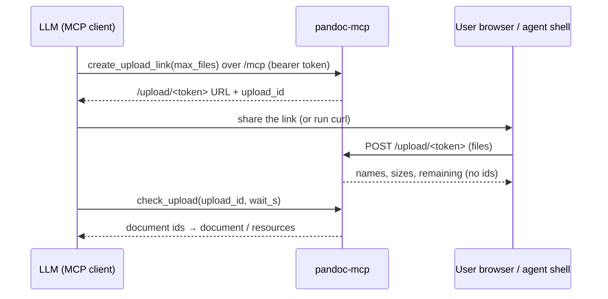

# Architecture

pandoc-mcp turns MCP tool calls into pandoc runs. It accepts a document (inline text, base64,
or the id of a stored document), runs pandoc in a throwaway directory, stores the result, and
returns it inline plus as a download link. This page explains how the pieces fit together. For
setup and usage, see the [README](../README.md).

## The big picture



Everything runs in one container, and pandoc does the actual conversion work. The Python
server checks input, chooses pandoc's arguments, and stores and returns results. The same code
also runs over stdio on a developer machine, using whatever pandoc, xelatex and mmdc are
installed there.

## Code layers

The server is built on [mcp-service-kit](https://github.com/geosp/mcp-service-kit), which
provides the stdio/HTTP transports, the CLI (`--mode`, `--port`, `--no-auth`) and env-based
config. Only the outer layer imports MCP.



| Module | Responsibility |
|---|---|
| `config.py` | `AppConfig` = kit's `BaseServerConfig` (`MCP_*`) + `PandocConfig` (`PANDOC_MCP_*`) |
| `pandoc_service.py` | The single use case: resolve input, build the pandoc command, run, store |
| `runner.py` | Starts pandoc, applies the timeout, maps a failure to `ConversionError`; format → extension/MIME tables |
| `documents.py` | Id-based file store with metadata and retention purge |
| `assets.py` | Resolves admin-installed assets **by name** |
| `uploads.py` | Short-lived upload links: hashed tokens, file limits, `upload_id` grants |
| `results.py` | Turns results and errors into MCP content |

## A conversion, step by step



Points worth knowing:

- **The input is one of four kinds.**
  - `contents`: text, typically something the LLM just wrote.
  - `contents_base64`: binary files such as docx, odt, epub or pptx.
  - `document`: chains on an earlier result or an upload.
  - `input_path`: a local file, only when local paths are allowed (stdio by default).
- **Every output is stored**, even when it is returned inline. The id makes multi-step
  round-trips (docx → md → edit → docx) possible without resending bytes.
- **Inline output.** Text comes back inline up to `MAX_INLINE_CHARS`, and binary up to
  `MAX_INLINE_BYTES` as an MCP `EmbeddedResource`. `inline=false` skips both.
- **Argument order matters.** `--defaults` goes first, so the flags that follow always override
  the defaults file. A defaults file cannot change the target format or the output path.
- **Formats come from pandoc.** They are read at startup (`--list-input/output-formats`), not
  from a hard-coded list.
- **Images come only from `resources`.** The listed documents are copied into
  `<workdir>/resources/`, and `filters/resources.lua` embeds matching images: a data URI for
  HTML, the media bag otherwise. Every other image path stays blocked by the sandbox.

## Uploads



The link is the only upload credential: `token_urlsafe(32)`, kept as a sha256 hash in memory.
It is upload-only, expires after `UPLOAD_LINK_TTL_S`, and closes after `max_files`. It is not
tied to an MCP session, because on protocol 2026-07-28 FastMCP's `session_id` changes with
every request. Instead the non-secret `upload_id`, which only the MCP caller receives, is the
handle for the results. The link will show up in transcripts; that is acceptable because it
is useless once spent or expired. A restart closes all links. Over stdio there are no links;
`input_path` is used instead.

## Storage

```
/data/documents/<uuid4 hex>/<filename>   the document
/data/documents/<uuid4 hex>/meta.json    source, formats, assets used, warnings, created
```

The random id is the access control for downloads: `GET /documents/<id>/<filename>` needs no
token, so treat links like shared secrets. Uploads need a link (see above). Documents older
than `RETENTION_DAYS` are purged at most once an hour, during a conversion.

## Assets

`assets/{filters,defaults,reference-docs,templates}` is installed by the administrator. In
Docker it is a read-only mount. Clients pass bare names (`"academic-pdf"`). Anything that looks
like a path is rejected, and a JSON filter is only offered if it is already executable. Adding a
style or filter therefore means dropping a file in that directory, with no code change.

## Mermaid

`filters/mermaid.lua` ships with the package and is not an asset. The server adds it
automatically when the input contains a mermaid code block and `mmdc` was found at startup.
It renders according to pandoc's output format:

- HTML: inline SVG, with a unique id per diagram.
- LaTeX/PDF: vector PDF.
- Office and other formats: PNG via the media bag.
- Markdown outputs: the code block is left as is.

A diagram that fails to render stays as code, and mermaid's error becomes a warning. This lets
the LLM fix the diagram and retry. Over HTTP the filter runs under `--sandbox`, which is fine
because it calls `pandoc.pipe` and writes its own temp files.

## Security model

The threat is an untrusted document or client over HTTP. Each defence maps to a concrete
attack that was tested:

| Attack | Defence |
|---|---|
| Image or include reference pulls in a server file (`` → docx) | `--sandbox` (on unless local paths are allowed) |
| Raw LaTeX `\input{/etc/passwd}`, `\write18` | TeX env `openin_any=p openout_any=p shell_escape=f` |
| Client-chosen filter, defaults file or template path runs code | Assets by name only; no chmod |
| Path traversal in upload names or output files | `safe_filename`, no `output_path` over HTTP |
| Runaway conversion | Subprocess timeout, then kill; input size limit |
| Unauthenticated use | Bearer token on `/mcp` (`BearerTokenVerifier`) |
| Server token handed to users or shells to upload | Upload links: upload-only, minutes, N files, hashed |
| Image reference used to read arbitrary files | Only listed `resources` are readable, by file name |

These are accepted risks. Filters in `assets/` are trusted code. Chromium runs mermaid without
its own sandbox, but inside the container, with mermaid's `strict` security level.
`PANDOC_MCP_MERMAID=false` turns it off.

## Extending

- **New tool:** add `features/<name>/tool.py` with `register_tool(mcp, pandoc: PandocService)`.
  It is discovered automatically. Keep the logic in `PandocService` and wrap calls in
  `tool_errors()`.
- **New option for `convert_document`:** add the parameter in the tool and the matching pandoc
  flag in `PandocService.convert`. If the option can name a file, make it an asset kind, never a
  path.
- **New format quirk:** update the tables in `runner.py` (`EXTENSIONS`, `BINARY_FORMATS`,
  `INPUT_BY_EXTENSION`, `MIME_TYPES`).

## Testing

Tests go through a real `fastmcp.Client` against the in-process server. HTTP routes are tested
via `httpx.ASGITransport`. Tests that need `pandoc`, `xelatex` or `mmdc` are skipped when those
are missing. The full suite runs inside the image:

```bash
docker run --rm --user 0 -v $PWD/tests:/app/tests:ro pandoc-mcp \
  sh -c 'uv sync --frozen -q && uv run --frozen pytest -q -p no:cacheprovider'
```
